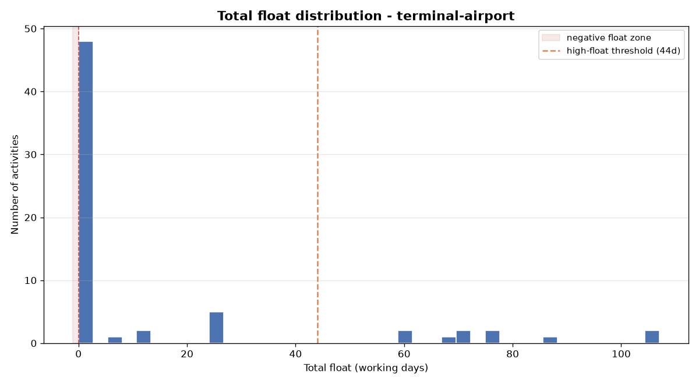
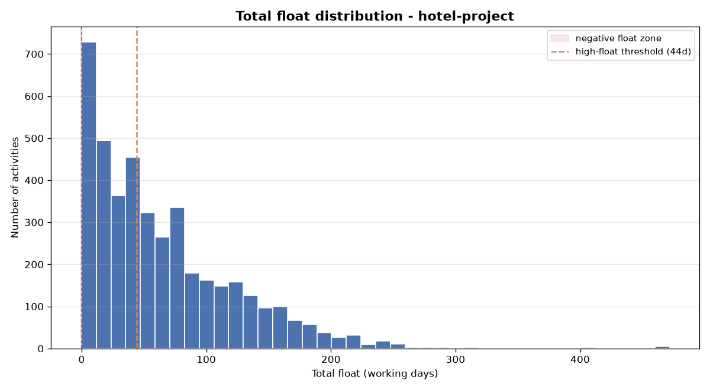
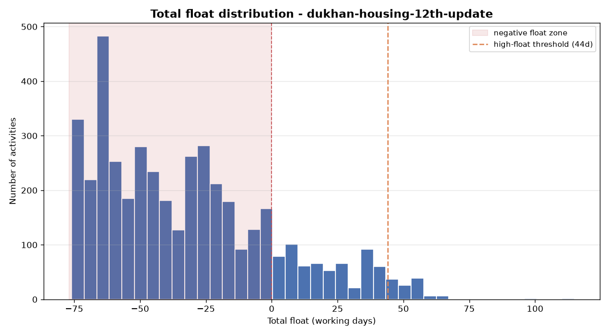

# p6-xer-checker

A small, dependency-light quality checker for **Primavera P6 `.xer` schedule
files**. It reads a schedule, flags broken rows, runs three basic
schedule-quality checks, and draws one chart.

The three checks are a subset of the industry-standard
[DCMA 14-Point Schedule Assessment](https://en.wikipedia.org/wiki/Defense_Contract_Management_Agency)
that planners use to sanity-check a P6 schedule.

---

## What is an `.xer` file?

Despite the extension, an `.xer` is just **plain tab-delimited text** (exported
by P6 in Windows-1252 encoding). Its structure:

```
ERMHDR  6.0  2013-01-22  ...        <- one header line (version, date, ...)
%T  TASK                            <- start of a table
%F  task_id  task_code  task_name  ...   <- that table's column names
%R  1001  A1000  Mobilize  ...      <- one data row (repeated)
%T  TASKPRED                        <- next table (the logic links)
...
%E                                  <- end of file
```

The two tables that matter here are **`TASK`** (the activities, including
`total_float_hr_cnt`) and **`TASKPRED`** (the predecessor/successor links).

The parser in [`p6check/parser.py`](p6check/parser.py) is ~40 lines of pure
standard library, so there is nothing proprietary to install.

---

## The three checks

| Check | Rule | Why it matters |
|-------|------|----------------|
| **Missing links** (open ends) | Activity has no predecessor and/or no successor | Breaks the CPM logic network; float can't be trusted. Start/finish milestones are allowed one open end. |
| **Negative float** | `total_float < 0` | The schedule is **behind**: the work can't finish within its deadline/constraint. |
| **High float** | `total_float > 44 working days` (configurable) | Usually a sign of **missing logic** or an unrealistic plan. |

Float is stored in hours in the `.xer`; the 44-working-day threshold is
converted using an 8-hour working day (= 352h).

"Broken rows" are data rows whose column count doesn't match their table
header. They're reported and skipped rather than crashing the run.

---

## Usage

```bash
pip install -r requirements.txt

python check_xer.py samples/terminal-airport.xer
python check_xer.py samples/hotel-project.xer --high-float-days 44 --out out
```

Options:

- `--high-float-days N` — high-float threshold in working days (default 44)
- `--out DIR` — where the chart PNG is written (default `out/`)
- `--no-chart` — skip the chart
- `--json` — print results as JSON instead of the text report (scriptable / CI-friendly)

Exit code is non-zero if any check fails (handy for CI).

---

## Sample output

```
======================================================================
  P6 SCHEDULE CHECK  -  terminal-airport.xer
======================================================================
  P6 export version : 5.0
  Activities (TASK) : 66
  Links (TASKPRED)  : 84
----------------------------------------------------------------------
  BROKEN ROWS: 0
    none - every data row matched its table header
----------------------------------------------------------------------
  CHECKS

  [pass] Missing links (open ends)
         0 of 66 activities (0.0%)

  [pass] Negative total float
         0 of 66 activities (0.0%)

  [FAIL] High total float (> 44 working days)
         10 of 66 activities (15.2%)
           - BA-P1-160      float=71.0d    P.C SOG
           ...
----------------------------------------------------------------------
  CHART: out/terminal-airport_float_distribution.png
======================================================================
```

### The one chart

A histogram of total float (in working days). The left red zone is the
negative-float region; the orange line is the high-float threshold.
Everything to its right is high float — so the chart shows two of the three
checks at a glance.

**terminal-airport.xer** (66 activities)



**hotel-project.xer** (4,236 activities)



**dukhan-housing-12th-update.xer** (5,609 activities, a real project running late)



---

## Findings on the three sample schedules

| File | Activities | Links | Broken | Missing links | Negative float | High float |
|------|-----------:|------:|-------:|--------------:|---------------:|-----------:|
| terminal-airport.xer | 66 | 84 | 0 | 0 | 0 | 10 (15%) |
| hotel-project.xer | 4,236 | 7,586 | 0 | 26 | 0 | 2,263 (53%) |
| dukhan-housing-12th-update.xer | 5,609 | 17,883 | 3 | 1 | **3,589 (64%)** | 114 (2%) |

The first two are **clean baselines**, so they carry no negative float — that's
normal, because negative float only appears once a schedule is progressed and
starts missing a deadline it's constrained to. The third file is a real
construction project's **12th monthly update**, and it shows exactly that: 64%
of its activities are behind, and it even has 3 genuinely broken rows (a
malformed `RISKTYPE` table) that the checker flags and skips. So all four
behaviours are demonstrated on **real published data**, not mock-ups.

A tiny hand-made fixture ([`tests/fixtures/broken_sample.xer`](tests/fixtures/broken_sample.xer))
also trips every check — it's used by the tests so they stay fast and
deterministic, independent of the large sample files.

---

## Tests

```bash
python tests/test_checks.py      # or: pytest
```

---

## The sample `.xer` files

All are publicly available Primavera P6 exports, included here for
demonstration:

- `samples/terminal-airport.xer` — a real airport terminal building schedule
  (P6 v5.0), via the public
  [CodeVision3000/P6-Viewer](https://github.com/CodeVision3000/P6-Viewer) repo.
- `samples/hotel-project.xer` — a real hotel construction schedule (P6 v6.0),
  same public source.
- `samples/dukhan-housing-12th-update.xer` — the 12th monthly update of a real
  housing construction project (P6 v17.12), via the public
  [Projecting-Success hackathon dataset](https://github.com/Projecting-Success-Solutions-Portal/hack26-autoplan-wbs-generator).
  Included because a progressed schedule is where negative float actually shows up.

---

## Project layout

```
check_xer.py            CLI entry point (report + chart)
p6check/
  parser.py             .xer -> tables, flags broken rows
  checks.py             the three checks + DCMA thresholds
  chart.py              the float-distribution chart
samples/                the public .xer files (2 clean baselines + 1 progressed)
tests/
  test_checks.py        smoke tests
  fixtures/broken_sample.xer   crafted file that trips every check
out/                    generated charts
```

## Scope / limitations

Intentionally small. It does **not** recalculate the CPM (it trusts P6's stored
float), and it covers 3 of the 14 DCMA checks. It's a readable starting point,
not a full schedule-analysis suite.
